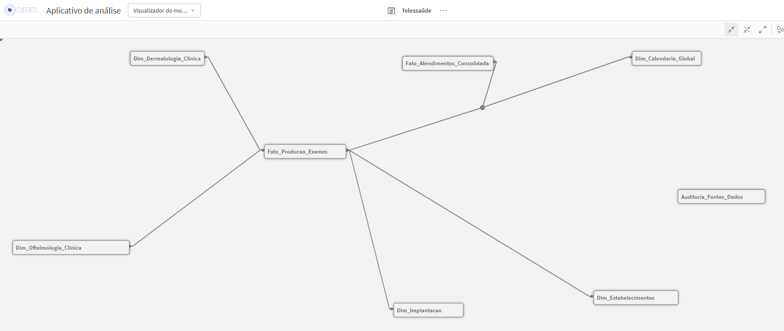
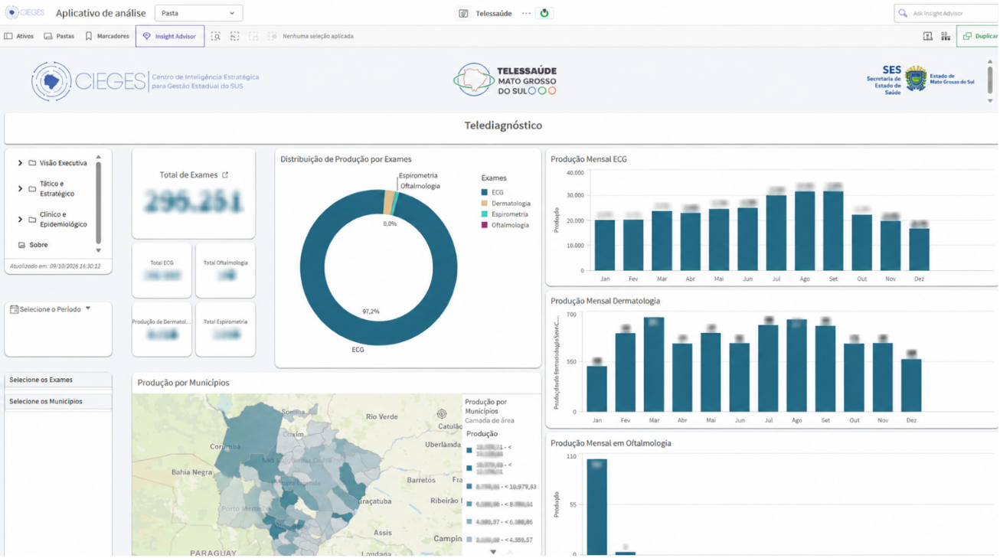
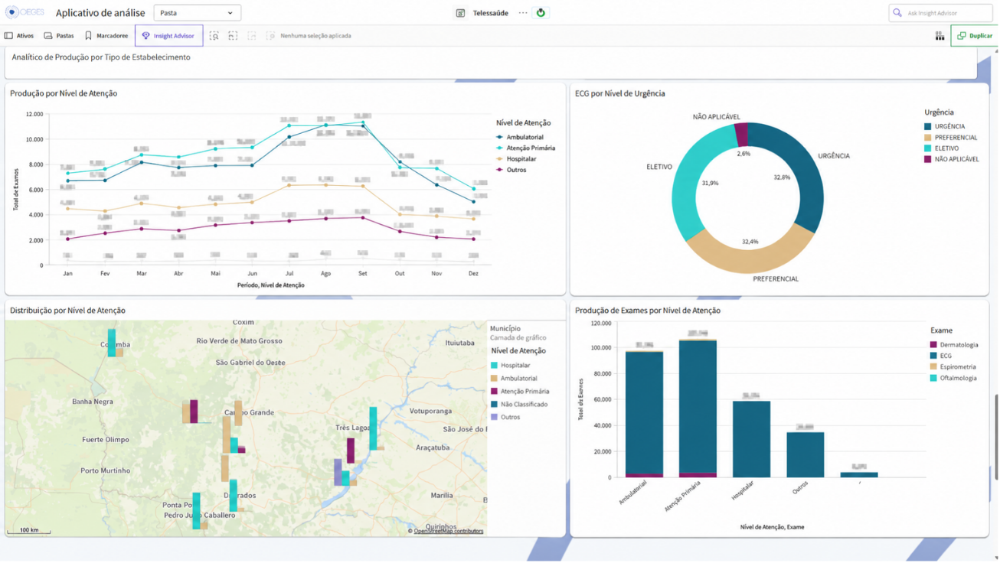
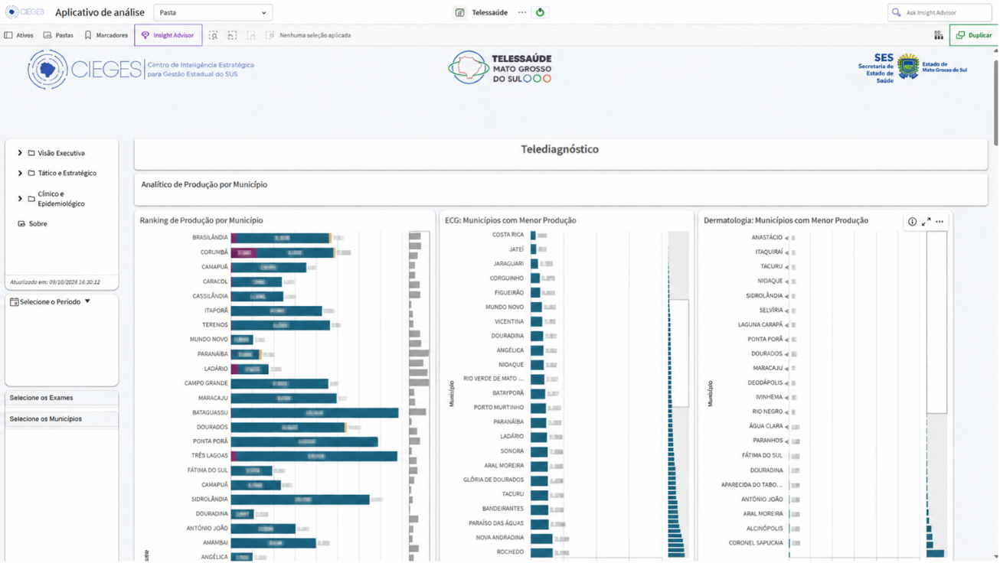
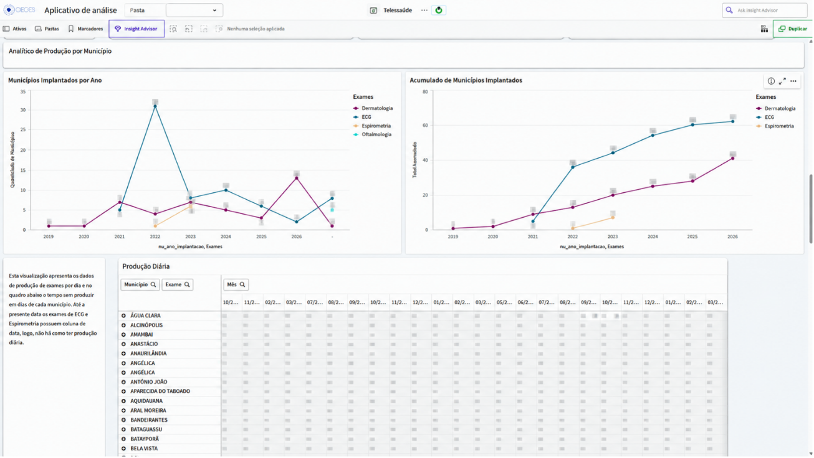

# Inteligência Estratégica & Governança DataOps (CIEGES)

> Arquitetura analítica moderna, governança de ciclo de vida de dados (DLM) e qualidade *Shift-Left* aplicadas à tomada de decisão executiva em Saúde Pública.

[](#)
[](#)
[](#)
[](#)
[](#)

---

## 1. Visão Executiva & Contexto do Negócio - Superintendência de Saúde Digital - Telessaúde

A gestão executiva da Superintendência de Saúde Digital (SSD / SES-MS) enfrentava desafios críticos que inviabilizavam a tomada de decisão em tempo oportuno:

* **Conflito de Números e Indicadores:** Áreas técnicas e regulatórias apresentavam totais discrepantes de exames para o mesmo período, pois cada sistema proprietário adotava critérios de corte e competências contábeis distintas.
* **Disparidade de Granularidade das Fontes:** Sistemas de teleconsulta registravam atendimentos evento a evento (granularidade transacional), enquanto os repositórios de laudos de ECG e espirometria disponibilizavam planilhas agregadas por mês/estabelecimento.
* **Inconsistência Cadastral no CNES:** Unidades de saúde eram cadastradas com nomes divergentes ou sem código CNES válido, impedindo a territorialização e a correlação com a rede oficial do Ministério da Saúde.
* **Risco de Abandono ("Cemitério de Dashboards"):** Fardous, 2023 define que falhas de qualidade e de metadados explicam 52,7% do fracasso de sistemas de BI. Dashboards criados sem governança e sem regras explícitas perdiam rapidamente a confiança dos tomadores de decisão.


```
       FONTES BRUTAS (RAW)                GOVERNANÇA SHIFT-LEFT               CAMADA ANALÍTICA (GOLD)
┌───────────────────────────────┐     ┌───────────────────────────┐     ┌───────────────────────────────┐
│ • Telediagnóstico STT         │     │                           │     │ • Fato_Producao_Exames        │
│ • Sis. de Teleconsultorias    │ ──> │   Contratos de Dados      │ ──> │ • Fato_Atendimentos           │
│ • API's (Oftalmo/Dermato)     │     │   YAML                    │     │ • Dim_Clínicas / CNES         │
│ • Cadastro Nacional (CNES)    │     │   Circuit Breaker & Regras│     │ • Calendário Global           │
└───────────────────────────────┘     └───────────────────────────┘     └───────────────────────────────┘
```

---

## 2. O Macroprocesso de Engenharia & Atendimento (BPMN)

Para assegurar previsibilidade e segregação estrita de funções, a esteira analítica foi mapeada sob a notação BPMN, articulando cinco áreas estruturadas:

1. **Áreas de Negócio & Demandantes (alta gestão):** Identificação da dor operacional e solicitação formal.
2. **Coordenação:** Alinhamento de prioridades, validação de patrocinadores institucionais e resolução de bloqueios.
3. **Especialista de Governança & Analytics:** Condução de avaliação de impacto, desenho de regras de negócio, modelagem dimensional e elaboração dos Contratos de Dados.
4. **Engenharia de Dados (DataOps):** Desenvolvimento das rotinas de ingestão na camada Bronze, transformação e execução dos contratos via pipeline automatizado (Raw $\rightarrow$ Silver).
5. **Parceiros Estratégicos (TI):** Gestão de acessos, segurança perimetral e disponibilidade de cluster.

```
+---------------------------------------------------------------------------------------------------+
| MACROPROCESSO DE SOLICITAÇÃO E ENGENHARIA DE DADOS                                                |
+---------------------------------------------------------------------------------------------------+
| [Alta GEstão] --> [Demanda Analítica]                                                             |
|                          │                                                                        |
| [Coordenação]            ▼                                                                        |
|               [Alinhamento Estratégico & Priorização]                                             |
|                          │                                                                        |
| [Especialista]           ├─> [Análise de Risco] ──> [Data Contract YAML]  ──> Visão de negócio    |
|                          │                                     │                                  |
| [Engenharia]             ▼                                     ▼                                  |
|               [Ingestão Raw/Staging] ───────────────> [Validação Shift-Left (CI/CD)]              |
|                                                                │                                  |
| [Analytics]                                                    ▼                                  |
|               [Publicação Gold / Qlik Sense] <─── [Modelagem Constellation]                       |
+---------------------------------------------------------------------------------------------------+
```

---

## 3. Arquitetura de Dados: Fact Constellation Schema

Diferente de esquemas estrela isolados que geram duplicidade dimensional, a camada Gold utiliza uma **Arquitetura Fact-Constellation**, garantindo flexibilidade analítica e eliminando chaves sintéticas (*synthetic keys*):

```
       [Dim_Dermatologia_Clinica]          [Fato_Atendimentos_Consolidada]
                    \ (cd_laudo_dermato)                 | (dt_referencia_global)
                     \                                   |
               [Fato_Producao_Exames] -------- [Dim_Calendario_Global]
                /         |          \                   
               /          |           \ (sk_implantacao)
              /           |            ---> [Dim_Implantacao]
             /            | (sk_estabelecimento_cnes)
            /             ---> [Dim_Estabelecimentos]
           / (cd_atendimento_oftalmo)
[Dim_Oftalmologia_Clinica]
```
<!-- Diagrama da Modelagem -->
<p align="center">
  
  <br>
  <em>Figura 2: Arquitetura dimensional Fact Constellation: integração de tabelas fato multi-granulares e dimensões clínicas especializadas.</em>
</p>

### Por que esta modelagem foi adotada?
1. **Eliminação de Synthetic Keys e Chaves Circulares:** Ao desacoplar os detalhes de laudo em dimensões satélites e criar uma dimensão temporal conforme (`Dim_Calendario_Global`), o modelo não gera produtos cartesianos nem chaves sintéticas de ligação.
2. **Separação de Produção vs. Diagnóstico:** A tabela `Fato_Producao_Exames` responde com extrema velocidade a consultas executivas de volume, enquanto as dimensões `Dim_Oftalmologia_Clinica` e `Dim_Dermatologia_Clinica` sustentam a análise clínica e epidemiológica de busca ativa sem onerar a memória.

## 4. De-Para da Engenharia: Problemas de Negócio vs. Soluções no Script Qlik

Abaixo está o detalhamento técnico que correlaciona cada desafio enfrentado com as decisões de engenharia aplicadas no script (`src/analytics/qlik/01_pipeline_telediagnostico_gold.qvs`):

### Seção 02: Dicionários Semânticos e Mapeamento Dual
* **Problema:** A prioridade dos exames de ECG vinha como texto livre ("URGENTE", "ELETIVA"), ordenando os relatórios de forma alfabética e não pela gravidade clínica. Além disso, bases do CNES utilizam código numérico para o Estado (50), enquanto arquivos operacionais utilizam a sigla "MS".
* **Solução:**
  * Uso do `Map_Prioridade_Dual` com a função `Dual(Texto, ValorNum)`: o usuário visualiza "URGÊNCIA" em tela, mas o motor de BI ordena prioritariamente pelo valor numérico `1`.
  * Uso de `Map_IBGE_UF` para converter automaticamente códigos de UF nas siglas canônicas correspondentes, permitindo junções unificadas.

### Seção 03 e 04: Carga de ECG e Espirometria (Harmonização de Granularidade)
* **Problema:** ECG continha somatórios pré-consolidados em planilhas do serviço federal, enquanto a espirometria era unitária (1 linha = 1 exame). O somatório simples de linhas distorcia o volume real de procedimentos.
* **Solução:**
  * No ECG, criou-se a métrica `qtd_exames = Alt(Num([Soma de quantidade]), 0)`.
  * Na Espirometria, definiu-se a constante `qtd_exames = 1`.
  * **Classificação Léxica de Contingência:** Implementação da função `WildMatch()` no campo `ds_categoria_contingencia`. Se o estabelecimento não for localizado no CNES oficial, ele é categorizado pelo nome da unidade (*Atenção Primária*, *Ambulatorial* ou *Hospitalar*).

### Seção 05: Fato e Dimensão de Oftalmologia
* **Problema:** A API de teleoftalmologia trazia mais de 40 colunas clínicas (laudos de escavação papilar, catarata, retinopatia diabética) e o campo `EstabelecimentoCNES` apontava para a central terceirizada de telelaudos, distorcendo o mapa estadual.
* **Solução:**
  * **Divisão de Responsabilidade:** O script divide a carga em duas partes: a produção numérica alimenta `Fato_Producao_Exames`, enquanto as informações clínicas detalhadas alimentam `Dim_Oftalmologia_Clinica`, unidas pela chave `cd_atendimento_oftalmo`.
  * **Higienização de CNES:** Preenchimento com máscara de 7 dígitos (`0000000`) e documentação de regra para exclusão da unidade centralizadora nas análises regionais através de *Set Analysis*.

### Seção 06 e 08: Dermatologia e Dimensão Clínica
* **Problema:** A triagem dermatológica continha informações sobre fototipo, tempo de doença e suspeitas de câncer de pele associadas a um número de laudo.
* **Solução:**
  * Concatenação da volumetria na Fato Geral (`Fato_Producao_Exames`) e isolamento dos atributos de biópsia e histórico médico na tabela satélite `Dim_Dermatologia_Clinica` conectada por `cd_laudo_dermato`.

### Seção 07: Dimensão Oficial de Estabelecimentos (CNES)
* **Problema:** As bases de atendimento traziam descrições não padronizadas de unidades de saúde.
* **Solução:**
  * Construção da chave sintética composta `sk_estabelecimento_cnes` (`Sigla_UF | Nome Fantasia` ou `Sigla_UF | CNES`) conectada à base homologada do Ministério da Saúde.
  * Mapeamento oficial do código `TP_UNIDADE` para a taxonomia padrão do SUS.

### Seção 08 (Implantação): Acompanhamento do Ciclo de Ativação
* **Problema:** Dificuldade em avaliar se a baixa produção de um município decorria de subutilização ou se o equipamento havia sido instalado recentemente.
* **Solução:**
  * Inclusão da tabela `Dim_Implantacao` conectada pela chave composta `Municipio | Serviço` (`sk_implantacao`), permitindo comparar a produção mensal com o marco temporal formal de ativação do ponto[cite: 4].

### Seção 09: Unificação de Teleatendimentos (Multifonte)
* **Problema:** Três plataformas distintas com layouts diferentes:
  1. *Núcleo Fiocruz:* Registro individualizado[cite: 4].
  2. *Hospital Albert Einstein (PROADI):* Relatórios agregados por competência[cite: 4].
  3. *Teleconsultorias:* Registros com modalidades síncronas e assíncronas concorrentes[cite: 4].
* **Solução:**
  * Concatenação sequencial na tabela `Fato_Atendimentos_Consolidada`[cite: 4].
  * Normalização da modalidade via regras condicionais, criando a dimensão canônica única `tp_modalidade` (*Teleinterconsulta*, *Teleconsulta*, *Teleconsultoria Síncrona*, *Teleconsultoria Assíncrona*)[cite: 4].

### Seção 10: Dimensão Calendário Mestre Conforme
* **Problema:** Formatos heterogêneos de data (`DD/MM/YYYY`, `YYYY-MM-DD`, `YYYY/MM`) causavam quebras no painel e impediam a utilização de um único seletor de data corporativo[cite: 4].
* **Solução:**
  * Identificação dinâmica dos limites temporais do projeto (`MinMaxDatas`) a partir das duas tabelas fato.
  * Geração dinâmica da `Dim_Calendario_Global` cobrindo o intervalo completo do ecossistema e ligada pelo campo padrão `dt_referencia_global`.

### Seção 11: Governança em Tempo de Execução (Auditoria de Fontes)
* **Problema:** Gestores tomavam decisões sem visibilidade sobre quando os arquivos e APIs haviam sido atualizados pelos provedores externos.
* **Solução:**
  * Criação da tabela ilha desacoplada `Auditoria_Fontes_Dados` que captura via `FileTime()` o momento exato de processamento de cada modalidade, expondo o SLA e o status da ultiam carga da informação (*Data Freshness*) diretamente na interface de visualização.

---

## 5. Visualização Executiva & Telas do Negócio

<!-- PAINÉIS EM PRODUÇÃO -->

<!-- 1. Tela Geral / Executiva -->
<p align="center">
  
  <br>
  <em>Figura 3.1: Visão Executiva — Monitoramento global de produção de exames, mapa de calor territorial e série temporal.</em>
</p>

<!-- 2. Tela Analítica 01 -->
<p align="center">
  
  <br>
  <em>Figura 3.2: Visão Tático-Estratégica — Detalhamento por município, acompanhamento de metas de implantação e adesão regional.</em>
</p>

<!-- 3. Tela Analítica 02 -->
<p align="center">
  
  <br>
  <em>Figura 3.3: Visão Clínico-Epidemiológica — Estratificação de laudos patológicos (oftalmo/dermato) e prioridades clínicas de atendimento.</em>
</p>

<!-- 4. Tela Analítica 03 -->
<p align="center">
  
  <br>
  <em>Figura 3.4: Visão Operacional — Controle de absenteísmo em teleconsultas e auditoria de frescor dos dados por fornecedor.</em>
</p>

### Principais Casos de Uso Habilitados
* **Gestão de Vazios Assistenciais:** Identificação imediata de municípios que possuem equipamentos de tele-ECG instalados, mas não registram exames há mais de 30 dias.
* **Busca Ativa de Casos Críticos:** Cruzamento de achados graves em teleoftalmologia (escavação papilar elevada ou retinopatia proliferativa) para acionamento das centrais de regulação e agendamento cirúrgico prioritário[cite: 1, 3, 4].
* **Monitoramento de SLA e Conectividade:** Controle operacional da resposta de telelaudos para suporte a contingências em emergências municipais.

### Componentes Centrais

* **Fato_Producao_Exames:** Consolidação de exames telediagnósticos (ECG, Espirometria, Teledermatologia e Teleoftalmologia) integrando bases tabulares e APIs REST.
* **Fato_Atendimentos_Consolidada:** Registro longitudinal de sessões clínicas síncronas e assíncronas (Teleconsultorias, Teleinterconsultas e Teleconsultas).
* **Dim_Calendario_Global (Dimensão Conforme):** Tabela mestre temporal contínua que unifica a navegação analítica sem provocar produtos cartesianos entre as tabelas fato.
* **Dimensões Clínicas Satélites:** Estruturas dedicadas (`Dim_Oftalmologia_Clinica`, `Dim_Dermatologia_Clinica`) que isolam diagnósticos, condutas e desfechos assistenciais da volumetria de produção.
* **Auditoria_Fontes_Dados (Metadata Island):** Módulo autônomo desacoplado que registra carimbos de carga (`FileTime`) para monitoramento de frescor e SLA dos dados.

---

## 4. Governança Shift-Left & Contratos de Dados (YAML)

A camada de qualidade opera sob a lógica **Shift-Left**: a validação é antecipada na transição Raw $\rightarrow$ Silver, bloqueando anomalias antes do processamento das regras da camada Gold.

Exemplo de especificação contratual (`contracts/01_telessaude/contract_telediagnostico.yaml`):

```yaml
metadata:
  nome_projeto: "Plataforma de Telessaúde e Telediagnóstico Estadual"
  versao_contrato: "1.0.0"
  status_documento: "Em Produção"

modelo_destino:
  camada: "SILVER_TRUSTED"
  nome_tabela: "fato_producao_exames_trusted"
  formato_saida: "Parquet"

esquema_colunas:
  - coluna_destino: "co_cnes"
    tipo_dado: "String"
    regras_validacao:
      obrigatorio_not_null: true
      formato_regex: "^[0-9]{7}$"

  - coluna_destino: "ds_tipo_exame"
    tipo_dado: "String"
    regras_validacao:
      obrigatorio_not_null: true
      valores_permitidos: ["Eletrocardiograma (ECG)", "Espirometria", "Teledermatologia", "Oftalmologia"]

politica_qualidade_dados:
  acao_em_caso_de_erro: "Quarentena e Notificação"
  limiar_tolerancia_erros_percentual: 1.0
```

Esteiras de automação no **GitHub Actions** em desenvolvimento.
---

## 5. Salvaguardas LGPD e Segurança da Informação

Em estrita consonância com a Lei Geral de Proteção de Dados (Lei nº 13.709/2018, Arts. 7º e 11):

1. **Pseudonimização e Anonimização:** Identificadores pessoais diretos (CPF, Cartão Nacional de Saúde - CNS).
2. **Camadas Agregadas no Front-End:** Métricas executivas operam em níveis agregados por unidade, serviço e município, impedindo a reidentificação de pacientes na camada pública de exploração.
3. **Controle de Acessos RBAC:**  Segmentação lógica de dados via Set Analysis, vinculada ao perfil de atuação, organograma e escopo de equipe do usuário.

---

## 6. Stack Tecnológica Aplicada

* **Governança & Processos:** DAMA-DMBOK Framework, Modelagem BPMN, OpenMetadata, Git/GitHub.
* **Engenharia & DataOps:** Contratos de Dados (YAML), Python, Apache Hop / Pipelines de Ingestão, GitHub Actions (CI/CD).
* **Armazenamento & Modelagem:** Lakehouse (Parquet), Arquitetura Medalhão (Raw $\rightarrow$ Silver $\rightarrow$ Gold), Star & Fact Constellation Schema.
* **Analytics Engineering:** Qlik Sense Scripting, Set Analysis Avançado, Power BI, Apache Superset.

---

## Licença

Distribuído sob licença MIT. Consulte `LICENSE` para obter mais informações.
